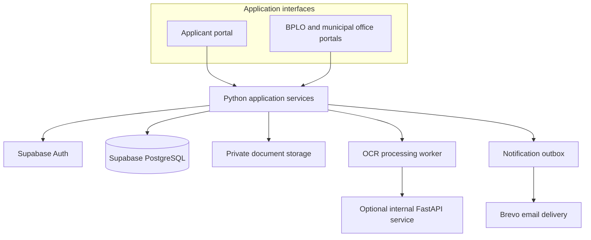

# E-Tech: A Centralized Business Process and Licensing System for the Municipality of Victoria, Laguna

> **Undergraduate Capstone Research — College of Computer Studies**  
> **Laguna State Polytechnic University — Santa Cruz Main Campus**  
> Bachelor of Science in Information Technology  
> **Designated evaluation submission account:** [`teamccs-git`](https://github.com/teamccs-git)

<p align="center">
  
  &nbsp;&nbsp;&nbsp;
  
</p>


**[Research website](https://siex1.github.io/E-Tech/)** · **[350-page manuscript](https://siex1.github.io/E-Tech/manuscript-viewer.html)** · **[Application source](https://github.com/tiennito/BPLO_System)** · **[Demonstration videos](https://drive.google.com/drive/folders/1NjH7QuwroE372udeUx_dCu-ORaLmgbN7)**

**Contents:** [Abstract](#research-context-and-project-abstract) · [Features](#six-core-research-features) · [Architecture](#system-architecture) · [Workflow](#permit-processing-workflow) · [Technology](#technology-and-component-responsibilities) · [Repository](#research-website-repository) · [Setup](#local-preview-and-deployment) · [Evaluation](#research-methodology-and-evaluation) · [Screenshots](#system-interface-gallery) · [Team](#research-team) · [Deliverables](#academic-deliverables-and-access)

---

## Research Context and Project Abstract

Business permit processing involves applicants, BPLO personnel, and municipal offices that review different requirements. Paper-based submissions and fragmented records can lead to repeated encoding, misplaced documents, processing delays, and difficulty tracking application progress.

**E-Tech** is a centralized web-based Business Process and Licensing System developed for the **Municipality of Victoria, Laguna**. It brings application information, documentary requirements, office reviews, inspection findings, assessment records, and permit processing into a connected workflow.

Applicants can submit requirements, review information extracted from documents, monitor applications, and respond to corrections. Authorized personnel use role-based workspaces to verify documents, coordinate municipal reviews, record findings, generate reports, and process permit release.

The research combines **descriptive-developmental research**, **Agile development**, **black-box functional testing**, and a **Technology Acceptance Model (TAM)-based user evaluation**.

### Academic Showcase and Repository Scope

This repository contains the **GitHub Pages research website**, public interface showcase, and watermarked manuscript previews. The full Python application, database migrations, and operational setup belong to the separate [BPLO_System repository](https://github.com/tiennito/BPLO_System).

The research website presents the project for academic review. Account registration, application submission, and municipal processing take place in the separate application.

---

## Six Core Research Features

| Feature | Purpose and behavior |
| --- | --- |
| **Multi-Office Inspection Scheduling** | Assigned municipal offices schedule inspections, record findings and checklist outcomes, attach evidence, and update inspection status. |
| **QR Code Generation** | Released permits include a verification link that supports retrieval or verification of eligible permit information. |
| **Email Notification** | Workflow events create notifications for submissions, corrections, inspection schedules, payment-related updates, and permit release. Transactional delivery uses Brevo. |
| **Report Generation** | Authorized staff select filters or reporting periods, review summaries, and export report files. |
| **Document Verification** | Documentary requirements are checked against the application, with discrepancies returned for review or correction. |
| **Optical Character Recognition** | Supported document uploads provide extracted field suggestions that applicants review and correct before submission. |

The system also supports **new applications, renewals, business closure requests, application tracking, and administrative monitoring**.

---

## System Architecture

The operational application connects role-based browser interfaces to Python application services and Supabase. The research website is published separately through GitHub Pages.



### Publication and Hosting

| Component | Location or role |
| --- | --- |
| Research presentation | [GitHub Pages — /E-Tech/](https://siex1.github.io/E-Tech/) |
| Research manuscript | [Watermarked 350-page reader](https://siex1.github.io/E-Tech/manuscript-viewer.html) |
| Application source | [tiennito/BPLO_System](https://github.com/tiennito/BPLO_System) |
| Supplied application address | [etech-victoria.up.railway.app](https://etech-victoria.up.railway.app/) — availability depends on the application deployment |
| Operational data and identity | Supabase PostgreSQL, Auth, and private Storage |
| Transactional email | Brevo |

---

## Permit Processing Workflow

| Stage | Responsible participant | Main activity |
| --- | --- | --- |
| **1. Prepare and submit** | Business applicant | Complete application details, upload requirements, review OCR suggestions, and submit. |
| **2. Check completeness** | BPLO personnel | Review information and documents; request corrections when necessary. |
| **3. Route and inspect** | BPLO and assigned municipal offices | Coordinate department reviews, inspection schedules, findings, and supporting evidence. |
| **4. Consolidate and assess** | BPLO personnel | Review required decisions, record applicable clearances, and prepare the assessment. |
| **5. Record payment evidence** | Municipal Treasury and BPLO | Treasury handles collection; BPLO records the applicable receipt and verification outcome. |
| **6. Finalize and release** | Authorized BPLO personnel | Complete release requirements and make eligible permit information available for verification. |

Returned requirements go back to the responsible applicant or office for correction. Assigned offices can perform their respective reviews independently when the workflow allows.

### Participants and Responsibilities

| Participant | Scope |
| --- | --- |
| **Business applicant** | Own applications, uploads, corrections, status tracking, renewals, closure requests, and released permits |
| **BPLO administrator and staff** | Intake, verification, routing, consolidated review, assessment, receipt recording, release, and reporting |
| **Super Administrator** | Account and department administration, configuration, and audit oversight |
| **Assigned municipal offices** | Department-specific review, inspection scheduling, checklist findings, and decisions |
| **BFP and Municipal Treasury** | External fire clearance and payment collection; applicable evidence is recorded in the application workflow |

### Scope and Limitations

- The study covers business permit processing for Victoria, Laguna.
- The system is web-based; a separate native mobile application is outside the stated scope.
- Online payment transactions are outside the stated scope.
- Direct integration with DTI, BIR, BFP, barangay offices, and the municipal treasury is outside the stated scope.
- Separate permits and clearances issued by other departments remain outside the covered BPLO business permit.

---

## Technology and Component Responsibilities

| Layer | Technology | Responsibility |
| --- | --- | --- |
| Research website | HTML, CSS, JavaScript | Research presentation, responsive navigation, interface previews, and manuscript reader |
| Application interfaces | HTML templates, CSS, JavaScript | Applicant forms, staff workspaces, review screens, and report previews |
| Application server | Python | Request handling, session checks, workflow rules, and service coordination |
| Identity and records | Supabase Auth and PostgreSQL | Account identity and application-processing records |
| Document storage | Private Supabase Storage | Uploaded requirements and inspection evidence |
| Document processing | Tesseract, PaddleOCR, TrOCR; optional FastAPI service | Engine-specific OCR and supported field extraction |
| Notifications | Outbox and Brevo | Workflow notification records and transactional email delivery |
| Hosting | GitHub Pages and Railway | Research publication and separate application hosting |

---

## Research Website Repository

| Path | Contents |
| --- | --- |
| `index.html` | Main research presentation: overview, team, objectives, methodology, features, results, and links |
| `manuscript-viewer.html` | Dedicated manuscript reader |
| `assets/manuscript-pages/` | Watermarked manuscript previews and reader assets |
| `assets/images/` | Municipal seals, team portraits, setting photograph, and interface screenshots |
| `assets/fonts/` | Local fonts used by the research website |
| `official-public-portal.html` | Public portal interface showcase |
| `business-permit-services.html` | Business permit services showcase |
| `requirements-checklists.html` | Application requirements showcase |
| `how-it-works.html` | Process guide |
| `faq.html` | Frequently asked questions |
| `research-styles.css` and theme stylesheets | Responsive layout and presentation styles |
| `research-script.js` | Navigation, tabs, and interface-preview interactions |
| `.nojekyll` | Static GitHub Pages publishing marker |

---

## Local Preview and Deployment

### Preview the Research Website

The research website requires no application build step.

```powershell
git clone https://github.com/Siex1/E-Tech.git
cd E-Tech
python -m http.server 8080
```

Open **http://localhost:8080**. A local Python installation is needed only for this preview server.

### Publish Through GitHub Pages

1. Open the repository's **Settings → Pages**.
2. Select **Deploy from a branch**.
3. Select **main** and **/(root)**, then save.
4. Check the **pages build and deployment** workflow in **Actions**.
5. Open **https://siex1.github.io/E-Tech/** after deployment succeeds.

Keep `index.html`, `.nojekyll`, and referenced assets at their current relative paths.

### Run the Operational Application

Use the installation instructions in the separate [application repository](https://github.com/tiennito/BPLO_System). Its Python environment, database migrations, credentials, OCR dependencies, and optional services are required for operational features. Serving this research repository does not start that application.

---

## Research Methodology and Evaluation

| Research element | Method |
| --- | --- |
| Research approach | Descriptive-developmental |
| Development model | Agile |
| Functional verification | Black-box testing across six research features |
| User evaluation | TAM-based questionnaire with five-point Likert responses |

### Functional Testing Results

**10 system testers evaluated 31 test cases. The manuscript reports 31 passed cases and no failed cases.**

| Feature | Test cases | Passed | Failed |
| --- | ---: | ---: | ---: |
| Optical Character Recognition | 4 | 4 | 0 |
| Email Notification | 9 | 9 | 0 |
| Document Verification | 3 | 3 | 0 |
| Multi-Office Inspection Scheduling | 5 | 5 | 0 |
| QR Code Generation | 5 | 5 | 0 |
| Report Generation | 5 | 5 | 0 |
| **Total** | **31** | **31** | **0** |

### User Acceptance Evaluation

| Respondent group | Respondents | Weighted mean | Standard deviation | Reported interpretation |
| --- | ---: | ---: | ---: | --- |
| Super User | 1 | 4.89 | 0.32 | Strongly Agree |
| BPLO Admin | 2 | 4.00 | 0.79 | Agree |
| BPLO Personnel | 12 | 4.61 | 0.53 | Strongly Agree |
| Business Applicants | 145 | 4.20 | 0.75 | Strongly Agree |
| **Overall** | **160** | **4.23** | **0.75** | **Strongly Agree** |

The evaluation comprises **18 statements and 2,880 recorded ratings** across quality factors, perceived ease of use, perceived usefulness, attitude toward using, behavioral intention to use, and user experience.

These are **reported research findings**, not a guarantee of future operational performance. The overall weighted mean follows the combined individual ratings rather than an unweighted average of respondent-group means. See the [manuscript](https://siex1.github.io/E-Tech/manuscript-viewer.html) for the study's methods, tables, and interpretation.

---

## System Interface Gallery

### BPLO Staff Dashboard


Application queues, status summaries, quick actions, and analytics. Personal record details are masked.

### Inspection Scheduling and Evidence


Inspection schedules, findings, evidence upload, and checklist controls. Location details are masked.

### Reports and Workflow Analytics


Reporting periods, workflow summaries, and export controls. The captured chart period contains no records.

Screenshots illustrate documented interface states; their displayed figures are not current municipal operational statistics.

---

## Research Team

| Proponent | Role |
| --- | --- |
| **Jasmine L. Geronimo** | Researcher |
| **Sebastien B. Hernandez** | Researcher |
| **Rickssie G. Hubahib** | Researcher |
| **Gener F. Mosico, MSIT** | Research Adviser |

**Institution:** Laguna State Polytechnic University — Santa Cruz Main Campus  
**College:** College of Computer Studies  
**Program:** Bachelor of Science in Information Technology

[View the team and portraits](https://siex1.github.io/E-Tech/#team)

---

## Academic Deliverables and Access

| Deliverable | Link |
| --- | --- |
| Research presentation website | [Open E-Tech](https://siex1.github.io/E-Tech/) |
| Full watermarked manuscript preview | [Read all 350 pages](https://siex1.github.io/E-Tech/manuscript-viewer.html) |
| Research website repository | [Siex1/E-Tech](https://github.com/Siex1/E-Tech) |
| Operational application source | [tiennito/BPLO_System](https://github.com/tiennito/BPLO_System) |
| Demonstration recordings | [Open demonstration folder](https://drive.google.com/drive/folders/1NjH7QuwroE372udeUx_dCu-ORaLmgbN7) |
| Evaluation submission account | [teamccs-git](https://github.com/teamccs-git) |

Naming the evaluation account identifies the designated destination; it does not establish that a submission, repository transfer, or collaborator invitation has been accepted.

## Academic Publication and Data Handling

Use sanitized screenshots and aggregate findings for public academic presentation. Applicant identifiers, signatures, receipts, private documents, credentials, and private storage links should stay out of public repository content.

This research edition provides watermarked manuscript previews. Keep original private documents and application configuration outside the website deployment.

---

**E-Tech · Victoria, Laguna · LSPU College of Computer Studies**  
Developed and presented for undergraduate capstone research and academic evaluation.
