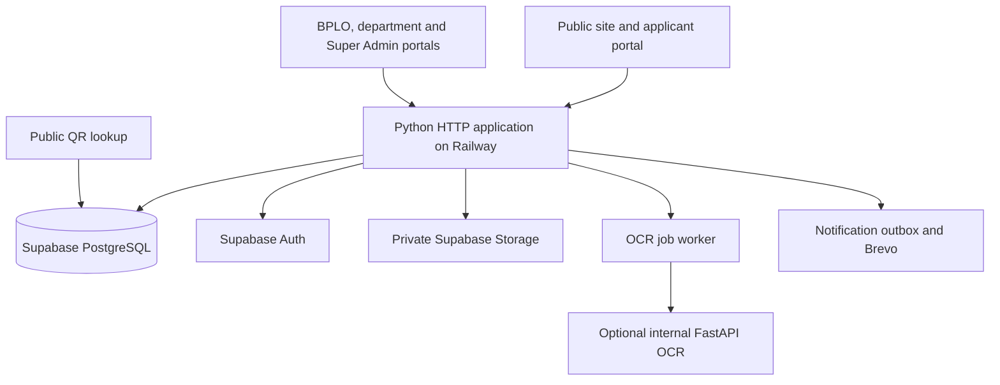

# E-Tech: A Centralized Business Process and Licensing System for the Municipality of Victoria, Laguna

 

**Undergraduate capstone research repository**<br>
Bachelor of Science in Information Technology · College of Computer Studies<br>
Laguna State Polytechnic University — Santa Cruz Main Campus

    

[Railway address · returned 404](https://etech-victoria.up.railway.app/) · [Documentation index](docs/README.md) · [Submission checklist](docs/SUBMISSION_CHECKLIST.md)

**Contents** · [Abstract](#research-context-and-abstract) · [Privacy](#academic-showcase-and-privacy) · [Features](#system-features) · [Architecture](#architecture-and-technology) · [Workflow](#permit-processing-and-responsibilities) · [Setup](#source-and-local-execution) · [Results](#research-findings) · [Screenshots](#system-screenshots) · [Credits and links](#proponents-and-deliverables)

---

## Research context and abstract

A business permit in Victoria passes through several offices. Applicants may supply the same business details on a form and in supporting certificates. For staff, finding which office still owes an inspection or clearance requires following one application across several decisions. E-Tech brings the submission, supporting files, office decisions, assessment and permit record together. Applicants can follow a case or correct an item online. Staff can see the evidence behind a decision and the steps still outstanding. OCR suggests entries for review. Treasury collection and fire clearance remain municipal transactions outside the portal.

## Academic showcase and privacy

This edition supports academic evaluation and archiving. The gallery uses demonstration screens and aggregate findings. Share only sanitized records with evaluators. Applicant identifiers, signatures, uploaded documents, receipts and private storage links belong in restricted systems. Keep credentials in local configuration or the host secret store. The repository is private and contains historical material outside this edition. Wider distribution requires a separate review of the full repository and its history. See the [security guide](docs/SECURITY_DOCUMENTATION.md) and the [Philippine Data Privacy Act of 2012](https://privacy.gov.ph/data-privacy-act/).

## System features

| Research feature | What the implementation does |
|---|---|
| Multi-office inspection scheduling | Each assigned office schedules inspections, records checklist findings and attaches evidence. BPLO checks completion across assignments. |
| QR code generation | Permit rendering embeds a verification URL. The public service checks currency, release and validity before granting eligible document access. |
| Email notification | Application events enter an outbox for delivery through Brevo. Staff can distinguish a workflow update from its delivery outcome. |
| Report generation | BPLO selects filters, previews the matching records and exports a report. |
| Document verification | Document-specific checks compare evidence with the application. BPLO reviews discrepancies and can return individual requirements for correction. |
| Optical character recognition | A worker extracts fields from supported uploads. Applicants review suggested values and correct them before submitting. |

## Architecture and technology



| Layer | Technology and responsibility |
|---|---|
| Browser | HTML templates, CSS and JavaScript implement forms, role workspaces and report previews. |
| Main server | Python HTTP handlers validate sessions, dispatch routes and coordinate transactions. |
| Data | Supabase Auth identifies accounts. PostgreSQL stores processing state. Private Storage holds documents and inspection evidence. |
| Document processing | Tesseract, PaddleOCR and TrOCR have engine-specific dependencies. A document flag controls whether the worker calls FastAPI. |
| Hosting and presentation | Railway is the supplied application host. Cloudflare appears in the optional custom-domain runbook. GitHub Pages is a separate academic publishing surface. The supplied Railway address and the previously associated Pages address both returned 404 during submission review. |

[Deployment topology, component boundaries and OCR sequence](docs/SYSTEM_ARCHITECTURE.md)

## Permit processing and responsibilities

For a new permit, the applicant registers, uploads requirements, reviews the form and submits. BPLO checks completeness and routes to applicable offices. Assigned offices can proceed independently on this branch. BPLO checks required decisions, external BFP evidence, the locked assessment and Treasury receipt before finalizing and releasing the permit. Returned cases go back to the responsible person for correction.

| Participant | Scope |
|---|---|
| Business applicant | Own drafts, uploads, applications, corrections, renewal, closure and released permits |
| BPLO staff administrator | Intake, routing, consolidated review, assessment, receipt recording, release and reports |
| Super Administrator | Accounts, department configuration, permits configuration and audit oversight |
| MPDC / Zoning | Assigned location and zoning review |
| Engineering / OBO | Assigned building and engineering review |
| Health and Sanitation | Assigned sanitary inspection and findings |
| MENRO | Assigned environmental review and evidence |
| Assessor | Assigned assessment-office requirements and decision |
| Market Office | Market-related review when assigned |
| BFP and Municipal Treasury | External fire clearance and payment collection respectively. BPLO records the applicable evidence. |

[New, renewal, closure, revision, assessment, release and public verification procedures](docs/SYSTEM_DOCUMENTATION.md)

## Source and local execution

```text
main.py                    Application entry point
backend/                   HTTP handlers, authorization, rules, OCR and reporting
static/                    Browser templates, styles, scripts and images
templates/                 Server-side project templates
database/                  Numbered SQL history and maintenance scripts
supabase/migrations/       Timestamped migrations
services/document-ai/      Optional private FastAPI service
scripts/                   Operations and verification utilities
tests/                     Unit, fixture and browser tests
docs/                      Academic guides and engineering evidence
```

```powershell
git clone https://github.com/tiennito/BPLO_System.git
cd BPLO_System
# To evaluate PR #67 before it merges, run these two commands here:
# git fetch origin refs/pull/67/head
# git switch --detach FETCH_HEAD
py -3.12 -m venv .venv-app
.\.venv-app\Scripts\python.exe -m pip install -r requirements.txt
Copy-Item .env.example .env
# Configure the isolated database and keys using the installation guide before starting.
.\.venv-app\Scripts\python.exe main.py
```

Open `http://127.0.0.1:8000`. The [installation guide](docs/INSTALLATION_GUIDE.md) covers the database baseline, migration order, environment, OCR service, tests and local prerequisites.

## Research findings

| Measure | Manuscript result |
|---|---|
| Black-box functional testing | 10 testers, 31 cases across six features, 31 passed |
| User evaluation | 160 respondents, 18 statements each, 2,880 ratings |
| Combined weighted mean | 4.23 / 5, SD 0.75, Strongly Agree |

These results describe the cases tested and the respondents surveyed. [Feature results, group sizes and applicant interpretation discrepancy](docs/RESEARCH_EVALUATION.md)

## System screenshots


*Figure 1. The public portal introduces permit services and provides entry points for applicants.*


*Figure 2. BPLO can preview the report before exporting it.* [Role-based screenshot gallery](docs/SYSTEM_SCREENSHOTS.md)

## Proponents and deliverables

**Research proponents** · Jasmine L. Geronimo · Sebastien B. Hernandez · Rickssie G. Hubahib<br>
**Capstone adviser** · Gener F. Mosico, MSIT

| Deliverable | Access |
|---|---|
| Application and source code | [Railway address · 404 at verification](https://etech-victoria.up.railway.app/) · [GitHub repository](https://github.com/tiennito/BPLO_System) · [Source and API guide](docs/SOURCE_CODE_GUIDE.md) |
| Technical documentation | [Diagram index and data dictionary](docs/README.md) |
| User documentation | [Four role manuals](docs/user-manual/README.md) · [Screenshots](docs/SYSTEM_SCREENSHOTS.md) |
| Operations | [Local installation](docs/INSTALLATION_GUIDE.md) · [Railway deployment and maintenance](docs/DEPLOYMENT_GUIDE.md) |
| Academic materials | Aggregate [research results](docs/RESEARCH_EVALUATION.md). Full manuscript publication approval was unavailable. The [previously associated Pages address](https://siex1.github.io/bplo-system/) returned 404. |
| Multimedia | [Project promotional video](static/assets/landing/etech-promo.mp4). A public full-system demonstration recording has not been confirmed. |

---

## 📊 Summary of Research Findings & Empirical Evaluation

System functionality and user acceptance were evaluated through **Black-Box Functional Testing** across **31 test cases by 10 system testers**, followed by a **Technology Acceptance Model (TAM)-based evaluation** covering **160 respondents**, **18 questionnaire statements**, and **2,880 individual ratings**.

### 1. Black-Box Functional Testing Results

| Test Suite / Research Feature | Evaluated Test Cases | Passed Cases | Failures | Pass Rate | Evaluation Verdict |
| --- | ---: | ---: | ---: | ---: | --- |
| **Feature 01: Optical Character Recognition (OCR)** | 4 | 4 | 0 | 100% | **Passed** |
| **Feature 02: Email Notification** | 9 | 9 | 0 | 100% | **Passed** |
| **Feature 03: Document Verification** | 3 | 3 | 0 | 100% | **Passed** |
| **Feature 04: Multi-Office Inspection Scheduling** | 5 | 5 | 0 | 100% | **Passed** |
| **Feature 05: QR Code Generation and Verification** | 5 | 5 | 0 | 100% | **Passed** |
| **Feature 06: Report Generation** | 5 | 5 | 0 | 100% | **Passed** |
| **Comprehensive Total** | **31** | **31** | **0** | **100%** | **All Reported Cases Passed** |

These results follow Chapter IV, Table 50 of the manuscript and describe the tested cases.

### 2. TAM-Based User Acceptance Evaluation Results

The evaluation involved **160 respondents**: **1 Super User**, **2 BPLO administrators**, **12 BPLO personnel**, and **145 business applicants**. Each respondent answered **18 statements** using a **five-point Likert scale**.

The instrument covered **Quality Factors**, **Perceived Ease of Use**, **Perceived Usefulness**, **Attitude Toward Using**, **Behavioral Intention to Use**, and **User Experience**.

| Respondent Group | Number of Evaluators | Weighted Mean | Standard Deviation | Verbal Interpretation |
| --- | ---: | ---: | ---: | --- |
| **Super User** | 1 | 4.89 | 0.32 | Strongly Agree |
| **BPLO Administrators** | 2 | 4.00 | 0.79 | Agree |
| **BPLO Personnel** | 12 | 4.61 | 0.53 | Strongly Agree |
| **Business Applicants** | 145 | 4.20 | 0.75 | Strongly Agree* |
| **Overall Evaluation** | **160** | **4.23** | **0.75** | **Strongly Agree** |

The overall result combines **2,880 individual ratings**; it is not an unweighted average of the four respondent-group means.

*The applicant interpretation follows manuscript Table 56. The statistical-results narrative labels the same displayed mean of 4.20 “Agree”; see the [research evaluation documentation](docs/RESEARCH_EVALUATION.md) for this source discrepancy.*

---

## 👥 Research Proponents & Advisory

This capstone research project was developed and evaluated by undergraduate researchers at the **College of Computer Studies, Laguna State Polytechnic University — Santa Cruz Main Campus**.

| Research Proponent | Role | Degree Program |
| --- | --- | --- |
| **Jasmine L. Geronimo** | Researcher | Bachelor of Science in Information Technology |
| **Sebastien B. Hernandez** | Researcher | Bachelor of Science in Information Technology |
| **Rickssie G. Hubahib** | Researcher | Bachelor of Science in Information Technology |

**Thesis / Capstone Adviser:** **Gener F. Mosico, MSIT**

**Institutional Department:** College of Computer Studies, Laguna State Polytechnic University  
**Campus:** Santa Cruz Main Campus, Santa Cruz, Laguna, Philippines  
**Research Locale:** Municipality of Victoria, Laguna, Philippines

[View the research team](https://siex1.github.io/E-Tech/#team)

---

## 🔗 Official Project Links & Deliverables

| Deliverable | Platform / Format | Direct URL |
| --- | --- | --- |
| **Web Application** | Railway deployment address | [https://etech-victoria.up.railway.app/](https://etech-victoria.up.railway.app/) |
| **Official Main Project Repository** | GitHub | [tiennito/BPLO_System](https://github.com/tiennito/BPLO_System) |
| **Capstone Research Website** | GitHub Pages | [https://siex1.github.io/E-Tech/](https://siex1.github.io/E-Tech/) |
| **Research Website Repository** | GitHub | [Siex1/E-Tech](https://github.com/Siex1/E-Tech) |
| **Capstone Thesis Manuscript** | Watermarked document viewer · 350 pages | [Read the E-Tech Research Manuscript](https://siex1.github.io/E-Tech/manuscript-viewer.html) |
| **System Demonstration Recordings** | Google Drive | [Open the Demonstration Folder](https://drive.google.com/drive/folders/1NjH7QuwroE372udeUx_dCu-ORaLmgbN7) |
| **Technical Documentation** | Repository documentation | [Documentation Index](docs/README.md) |
| **User Documentation** | Role-based manuals | [User Manuals](docs/user-manual/README.md) |
| **Evaluation Submission Account** | GitHub Account | [`teamccs-git`](https://github.com/teamccs-git) |

The application address depends on the Railway deployment's availability. The research website and manuscript links above use the current **/E-Tech/** address. The evaluation account identifies the designated submission destination; acceptance or collaborator access has not been confirmed.
