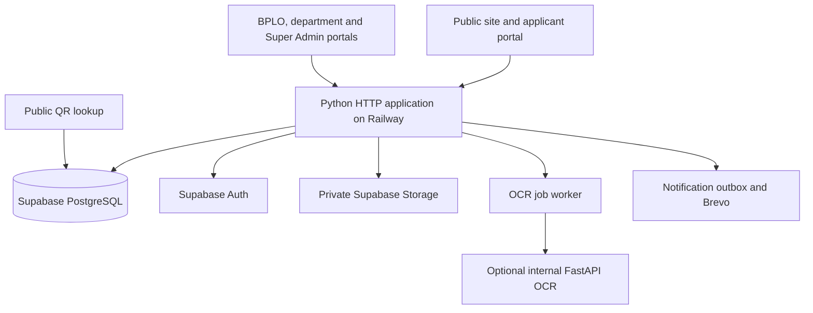
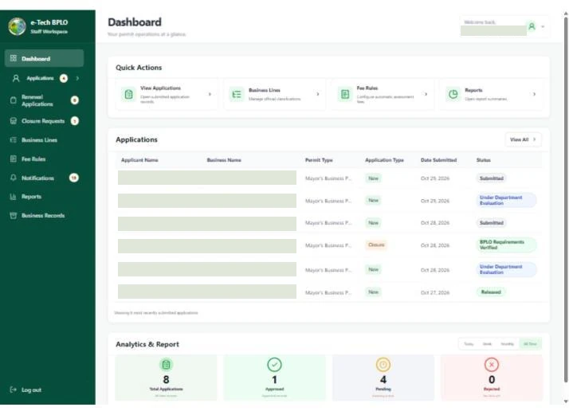
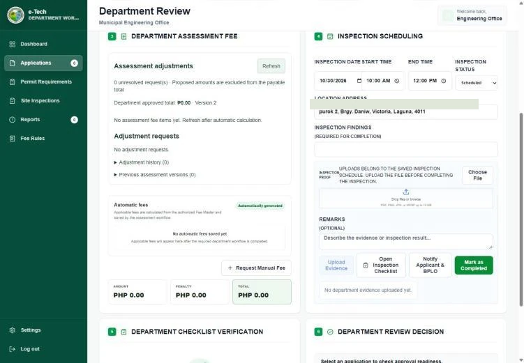
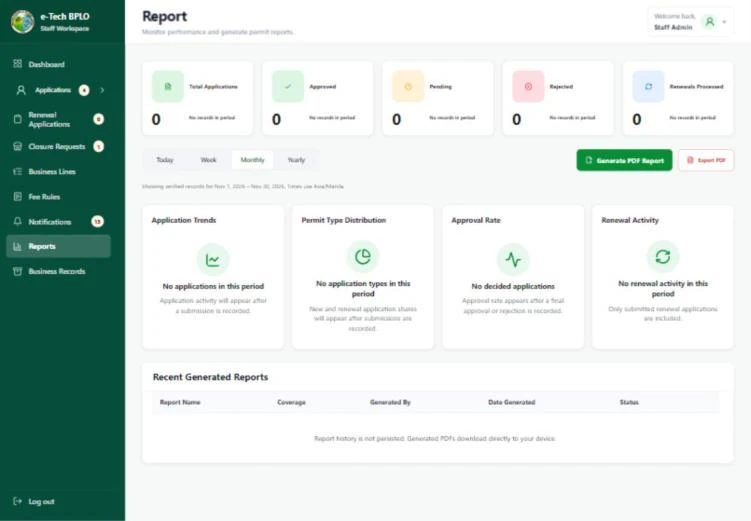

# E-Tech: A Centralized Business Process and Licensing System for the Municipality of Victoria, Laguna

> **Undergraduate Capstone Research Repository — College of Computer Studies**  
> **Laguna State Polytechnic University — Santa Cruz Main Campus**  
> **Evaluation Submission Account:** [`teamccs-git`](https://github.com/teamccs-git)

[](https://lspu.edu.ph/)


**[Research Website](https://siex1.github.io/E-Tech/)** · **[Read Manuscript](https://siex1.github.io/E-Tech/manuscript-viewer.html)** · **[System Demonstration](https://drive.google.com/drive/folders/1NjH7QuwroE372udeUx_dCu-ORaLmgbN7)**

[Overview](#research-context-and-abstract) · [Features](#system-features) · [Architecture](#architecture-and-technology) · [Workflow](#permit-processing-and-responsibilities) · [Repository Guide](#repository-guide) · [Research Findings](#-summary-of-research-findings--empirical-evaluation) · [Team](#-research-proponents--advisory) · [Deliverables](#-official-project-links--deliverables)

---

## Research context and abstract

A business permit in Victoria passes through several offices. Applicants may supply the same business details on a form and in supporting certificates. For staff, finding which office still owes an inspection or clearance requires following one application across several decisions. E-Tech brings the submission, supporting files, office decisions, assessment and permit record together. Applicants can follow a case or correct an item online. Staff can see the evidence behind a decision and the steps still outstanding. OCR suggests entries for review. Treasury collection and fire clearance remain municipal transactions outside the portal.

This repository publishes the **academic research website**: the project overview, research team, interface showcase, evaluation findings, and 350-page watermarked manuscript viewer.

---

## System features

| Research feature | What the implementation does |
|---|---|
| Multi-office inspection scheduling | Each assigned office schedules inspections, records checklist findings and attaches evidence. BPLO checks completion across assignments. |
| QR code generation | Permit rendering embeds a verification URL. The public service checks currency, release and validity before granting eligible document access. |
| Email notification | Application events enter an outbox for delivery through Brevo. Staff can distinguish a workflow update from its delivery outcome. |
| Report generation | BPLO selects filters, previews the matching records and exports a report. |
| Document verification | Document-specific checks compare evidence with the application. BPLO reviews discrepancies and can return individual requirements for correction. |
| Optical character recognition | A worker extracts fields from supported uploads. Applicants review suggested values and correct them before submitting. |

---

## Architecture and technology



| Layer | Technology and responsibility |
|---|---|
| Browser | HTML templates, CSS and JavaScript implement forms, role workspaces and report previews. |
| Main server | Python HTTP handlers validate sessions, dispatch routes and coordinate transactions. |
| Data | Supabase Auth identifies accounts. PostgreSQL stores processing state. Private Storage holds documents and inspection evidence. |
| Document processing | Tesseract, PaddleOCR and TrOCR have engine-specific dependencies. A document flag controls whether the worker calls FastAPI. |
| Hosting and presentation | GitHub Pages publishes this research website at https://siex1.github.io/E-Tech/. The operational application is hosted separately. |


---

## Permit processing and responsibilities

For a new permit, the applicant registers, uploads requirements, reviews the form and submits. BPLO checks completeness and routes to applicable offices. Assigned offices can proceed independently on this branch. BPLO checks required decisions, external BFP evidence, the locked assessment and Treasury receipt before finalizing and releasing the permit. Returned cases go back to the responsible person for correction.

| Participant | Scope |
|---|---|
| Business applicant | Own drafts, uploads, applications, corrections, renewal, closure and released permits |
| BPLO staff administrator | Intake, routing, consolidated review, assessment, receipt recording, release and reports |
| Super Administrator | Accounts, department configuration, permits configuration and audit oversight |
| MPDC / Zoning | Assigned location and zoning review |
| Engineering / OBO | Assigned building and engineering review |
| Health and Sanitation | Assigned sanitary inspection and findings |
| MENRO | Assigned environmental review and evidence |
| Assessor | Assigned assessment-office requirements and decision |
| Market Office | Market-related review when assigned |
| BFP and Municipal Treasury | External fire clearance and payment collection respectively. BPLO records the applicable evidence. |


---

## Repository Guide

| Location | Contents |
| --- | --- |
| `index.html` | Main research website |
| `README.md` | Project overview, findings, team, and academic deliverables |
| `manuscript-viewer.html` | Manuscript reader entry point, retaining the shared URL |
| `assets/css/` | Website stylesheets |
| `assets/js/` | Website interaction scripts |
| `assets/pages/` | Public portal, permit services, requirements, process guide, and FAQ pages |
| `assets/images/` | Municipal seals, team portraits, photographs, and system screenshots |
| `assets/fonts/` | Local fonts and license |
| `assets/manuscript-pages/` | Watermarked manuscript page previews |
| `assets/manuscript-viewer.css` and `assets/manuscript-viewer.js` | Manuscript reader styling and behavior |

### Local Preview

```powershell
git clone https://github.com/Siex1/E-Tech.git
cd E-Tech
python -m http.server 8080
```

Open **http://localhost:8080**. The research website requires no build step; Python provides the optional local preview server.

### GitHub Pages

Publish from **main → /(root)** through **Settings → Pages**. The website address is **https://siex1.github.io/E-Tech/**. Keep the `.nojekyll` marker and relative asset paths when deploying.

---

## 📊 Summary of Research Findings & Empirical Evaluation

System functionality and user acceptance were evaluated through **Black-Box Functional Testing** across **31 test cases by 10 system testers**, followed by a **Technology Acceptance Model (TAM)-based evaluation** covering **160 respondents**, **18 questionnaire statements**, and **2,880 individual ratings**.

### 1. Black-Box Functional Testing Results

| Test Suite / Research Feature | Evaluated Test Cases | Passed Cases | Failures | Pass Rate | Evaluation Verdict |
| --- | ---: | ---: | ---: | ---: | --- |
| **Feature 01: Optical Character Recognition (OCR)** | 4 | 4 | 0 | 100% | **Passed** |
| **Feature 02: Email Notification** | 9 | 9 | 0 | 100% | **Passed** |
| **Feature 03: Document Verification** | 3 | 3 | 0 | 100% | **Passed** |
| **Feature 04: Multi-Office Inspection Scheduling** | 5 | 5 | 0 | 100% | **Passed** |
| **Feature 05: QR Code Generation and Verification** | 5 | 5 | 0 | 100% | **Passed** |
| **Feature 06: Report Generation** | 5 | 5 | 0 | 100% | **Passed** |
| **Comprehensive Total** | **31** | **31** | **0** | **100%** | **All Reported Cases Passed** |

These results follow Chapter IV, Table 50 of the manuscript and describe the tested cases.

### 2. TAM-Based User Acceptance Evaluation Results

The evaluation involved **160 respondents**: **1 Super User**, **2 BPLO administrators**, **12 BPLO personnel**, and **145 business applicants**. Each respondent answered **18 statements** using a **five-point Likert scale**.

The instrument covered **Quality Factors**, **Perceived Ease of Use**, **Perceived Usefulness**, **Attitude Toward Using**, **Behavioral Intention to Use**, and **User Experience**.

| Respondent Group | Number of Evaluators | Weighted Mean | Standard Deviation | Verbal Interpretation |
| --- | ---: | ---: | ---: | --- |
| **Super User** | 1 | 4.89 | 0.32 | Strongly Agree |
| **BPLO Administrators** | 2 | 4.00 | 0.79 | Agree |
| **BPLO Personnel** | 12 | 4.61 | 0.53 | Strongly Agree |
| **Business Applicants** | 145 | 4.20 | 0.75 | Strongly Agree* |
| **Overall Evaluation** | **160** | **4.23** | **0.75** | **Strongly Agree** |

The overall result combines **2,880 individual ratings**; it is not an unweighted average of the four respondent-group means.

*The applicant interpretation follows manuscript Table 56. The statistical-results narrative labels the same displayed mean of 4.20 “Agree”; see the [research manuscript](https://siex1.github.io/E-Tech/manuscript-viewer.html) for this source discrepancy.*

---

---

## System Screenshots

### BPLO Staff Dashboard



Application queues, quick actions, and analytics; personal details are masked.

### Inspection Scheduling and Evidence



Municipal inspection schedules, findings, evidence upload, and checklist controls; location details are masked.

### Reports and Workflow Analytics



Reporting periods, workflow summaries, and export controls. The captured chart period contains no records.

---

## 👥 Research Proponents & Advisory

This capstone research project was developed and evaluated by undergraduate researchers at the **College of Computer Studies, Laguna State Polytechnic University — Santa Cruz Main Campus**.

| Research Proponent | Role | Degree Program |
| --- | --- | --- |
| **Jasmine L. Geronimo** | Researcher | Bachelor of Science in Information Technology |
| **Sebastien B. Hernandez** | Researcher | Bachelor of Science in Information Technology |
| **Rickssie G. Hubahib** | Researcher | Bachelor of Science in Information Technology |

**Thesis / Capstone Adviser:** **Gener F. Mosico, MSIT**

**Institutional Department:** College of Computer Studies, Laguna State Polytechnic University  
**Campus:** Santa Cruz Main Campus, Santa Cruz, Laguna, Philippines  
**Research Locale:** Municipality of Victoria, Laguna, Philippines

[View the research team](https://siex1.github.io/E-Tech/#team)

---

---

## 🔗 Official Project Links & Deliverables

| Deliverable | Platform / Format | Direct URL |
| --- | --- | --- |
| **Capstone Research Website** | GitHub Pages | [https://siex1.github.io/E-Tech/](https://siex1.github.io/E-Tech/) |
| **Official Research Website Repository** | GitHub | [Siex1/E-Tech](https://github.com/Siex1/E-Tech) |
| **Capstone Thesis Manuscript** | Watermarked viewer · 350 pages | [Read the E-Tech Research Manuscript](https://siex1.github.io/E-Tech/manuscript-viewer.html) |
| **Web Application** | Railway deployment address | [https://etech-victoria.up.railway.app/](https://etech-victoria.up.railway.app/) |
| **System Demonstration Recordings** | Google Drive | [Open the Demonstration Folder](https://drive.google.com/drive/folders/1NjH7QuwroE372udeUx_dCu-ORaLmgbN7) |
| **Evaluation Submission Account** | GitHub Account | [`teamccs-git`](https://github.com/teamccs-git) |

The Railway address depends on the separate application's deployment availability. The evaluation account identifies the designated destination; submission acceptance has not been confirmed.

---

## Academic Showcase and Privacy

The website presents documented interfaces and aggregate research results. Screenshots use masked personal details, and the manuscript is provided as watermarked page previews. Keep applicant documents, signatures, receipts, credentials, original private PDFs, and private storage links outside the public website.

**E-Tech · Municipality of Victoria, Laguna · LSPU College of Computer Studies**
